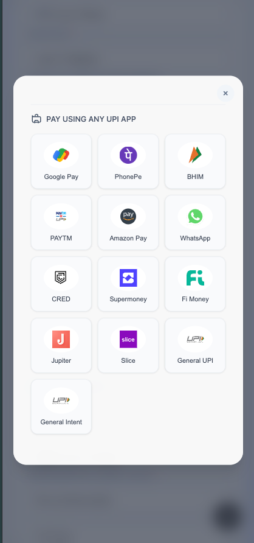
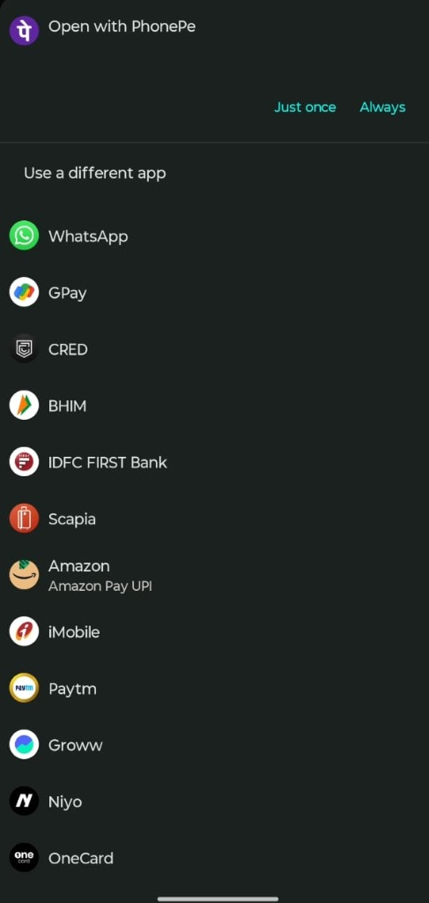

# Introduction

The Server-to-Server (S2S) UPI Intent integration eliminates redirection hops by initiating transactions from your backend.

<CardGroup cols={3}>
  <Card title="No Redirect Hops" icon="arrow-right" href="#step-2-initiate-payment">
    Initiate transactions directly from your server — the buyer stays on your page
  </Card>
  <Card title="Flexible Intent Invocation" icon="phone" href="#step-3-invoke-upi-intent">
    Call Create Order when the user selects an app (Mobile) or scans a QR code (Desktop)
  </Card>
  <Card title="Robust Server Callbacks" icon="server" href="#step-5-eximpe-sends-webhook-response">
    Receive asynchronous status updates via server-to-server callbacks
  </Card>
</CardGroup>

<Info>
  **Collection is only half the flow.** When a payment is captured it goes to **Under Review** if the order already has every detail its purpose code needs. Otherwise it goes to **Action Required** until you send what is missing. See [Step 6](#step-6-assert-compliance) below.
</Info>

### Intent Invocation

Intent invocation packages your UPI payment details — amount, payee VPA, reference — into a deep-link URI, then launches the buyer's UPI app directly from your front end. With a **specific intent**, you target a known app (e.g. Google Pay); a **generic intent** lets Android show an app picker (on iOS it falls back to the default handler).

## Prerequisites

Before you begin, ensure you have:

- **Credentials**: Your Client ID and Client Secret
- **Domain Whitelist**: Whitelisted your website domain for integration
- **Webhook URL**: A secure endpoint to receive payment status updates
- **cURL or HTTP Client**: Capability to make HTTPS `POST` and `GET` requests from your server.
- **UPI Knowledge**: Familiarity with UPI intent URL parameters and encoding.

Steps:

1. **User selects UPI App (Mobile) or QR Code (Desktop)** on your frontend.
2. **Frontend calls your Backend** to initiate the payment.
3. **Backend calls [Create Order](/api-reference/v3/order/create)** (`POST /pg/orders/` with `collection_mode: s2s`) to get the `intent_uri`.
4. **Backend returns `intent_uri`** to the Frontend.
5. **Frontend invokes the UPI Intent** on the buyer’s device.
6. **Check UPI transaction status** via API or Webhook.

## Step 1: Payment Page UI

Design your payment page to allow users to select their preferred UPI method.

#### Desktop (PC)

On desktop browsers, prepare a container to display a **QR Code**. When the user proceeds, you will generate this QR code from the intent URI.

#### Mobile (Android & iOS)



For mobile devices, design a list of popular UPI apps (like Google Pay, PhonePe, Paytm) for the buyer to select from.

## Step 2: Initiate Payment

When the user clicks on a specific UPI app icon (e.g., Google Pay) on mobile or selects "Show QR" on desktop, your backend calls [Create Order](/api-reference/v3/order/create) (`POST /pg/orders/`) to generate the `intent_uri`.

#### Sample UPI Intent Request Body

```json
{
  "amount": "1000.00",
  "collection_mode": "s2s",
  "upi_flow_type": "intent",
  "currency": "INR",
  "reference_id": "S2SI-U8MEIT",
  "mop_type": "upi",
  "buyer": {
    "name": "John Doe",
    "email": "john.doe@example.com",
    "phone": "+919876543210",
    "address": {
      "line_1": "123 Main Street",
      "line_2": "Apt 4B",
      "city": "City",
      "state": "State",
      "postal_code": "110001"
    },
    "ip_address": "192.168.1.100",
    "user_agent": "Mozilla/5.0 (Windows NT 10.0; Win64; x64) AppleWebKit/537.36 (KHTML, like Gecko) Chrome/91.0.4472.124 Safari/537.36"
  },
  "product": {
    "name": "Sample Product",
    "description": "This is a sample product description",
    "hs_code": "84713010",
    "hs_code_description": "Portable automatic data processing machines",
    "type_of_goods": "physical_goods"
  },
  "invoice": {
    "number": "INV_V9TZZ3",
    "date": "2025-07-08"
  }
}
```

<Note>
  For the S2S UPI Intent request, include these parameters alongside `amount`, `currency`, `reference_id`, `buyer`, `product`, and `invoice`:

  - `collection_mode`: must be set to `"s2s"`
  - `upi_flow_type`: must be set to `"intent"`
  - `buyer.ip_address`: the buyer’s device IP address
  - `buyer.user_agent`: the buyer’s browser or app user-agent string
</Note>

### S2S UPI Intent Response

```json
{
  "success": true,
  "message": "S2S UPI Request created successfully",
  "data": {
    "intent_uri": "pa=collect.sandbox@examplebank&pn=&tr=403993715534292371&tid=TXN403993715534292371080725205418&am=1000.00&cu=INR&tn=UPIIntent",
    "order_id": "OD2000992103",
    "expires_at": "2026-09-21T10:35:00.156967Z"
  }
}
```

For S2S UPI Intent mode, the response includes:

- `order_id`: Unique order identifier
- `intent_uri`: UPI intent link that can be used to open UPI apps directly
- `expires_at`: When the intent stops accepting payment, in UTC — 5 minutes after creation
- `test_simulator_url`: **Sandbox only** — a URL you open in a browser to complete the payment without a real UPI app

<Tip>
  **Testing in sandbox:** the sandbox response includes an additional `test_simulator_url`. Open it in a browser to simulate the payment flow and complete the transaction without needing a real UPI app or a mobile device — useful when developing the desktop QR path or testing on a machine with no UPI app installed.

  Open `test_simulator_url` and choose the outcome there. On some sandbox accounts the outcome follows the test VPA instead: `testsuccess@gocash` succeeds, `testfailure@gocash` fails.

  This field is **not returned in production**.
</Tip>

**Explanation of URL Arguments**

| Argument | Example Value   | Required | Description                                                                                      |
| -------- | --------------- | -------- | ------------------------------------------------------------------------------------------------ |
| `pa`     | `merchant@bank` | Yes      | Payee VPA (Virtual Payment Address) — the merchant's UPI ID that will receive the payment        |
| `pn`     | `Merchant Name` | Yes      | Payee Name — the display name of the merchant                                                    |
| `am`     | `100.00`        | No       | Amount — the payment amount (decimal, up to two places)                                          |
| `cu`     | `INR`           | Yes      | Currency — must be `INR` for Indian rupees                                                       |
| `tr`     | `TXN12345`      | Yes      | Transaction Reference ID — unique identifier for this transaction (for reconciliation)           |
| `tid`    | `TXNID98765`    | No       | Transaction ID — a unique transaction ID (sometimes required by specific apps, e.g., Google Pay) |
| `tn`     | `Order Payment` | No       | Transaction Note — a short note or description for the payment                                   |

## Step 3: Invoke UPI Intent

The method for invoking a UPI payment depends on the buyer's device and operating system.

#### Desktop (PC)

On desktop browsers, use the `intent_uri` to generate a **QR Code**. The user can then scan this code with their mobile UPI app to complete the payment.

`intent_uri` is either a full URI (`upi://pay?pa=...`) or only its query string (`pa=...`). For the QR and the generic intent, use it as is if it starts with `upi://`; otherwise prefix `upi://pay?`. For the Android `intent://pay?<query>` and iOS `<scheme_prefix><query>` formats, use the query string only: strip a leading `upi://pay?` first.

**Implementation:**
1. If the `intent_uri` does not start with `upi://`, prefix it with `upi://pay?`
2. Use a QR code generation library or API to convert the full URI into a QR code image.
3. Display the QR code prominently with instructions like "Scan to Pay".

***PC Specific App Format***:
```text
upi://pay?<query>
```


**Examples:**

<CodeGroup>
```text
upi://pay?pa=merchant@bank&pn=Merchant&am=1.00&cu=INR&tr=TXN123
```
</CodeGroup>

#### Mobile (Android & iOS)

For mobile devices, use the `intent_uri` to directly launch the buyer's UPI application — no manual data entry needed.

##### 1. Specific App Invocation (Android & iOS)

To target a specific app, use the following schemes:

| UPI App      | Android Package Name (for Intent URL)    | iOS URL Scheme Prefix |
| ------------ | ---------------------------------------- | --------------------- |
| Google Pay   | `com.google.android.apps.nbu.paisa.user` | `gpay://upi/pay?`     |
| PhonePe      | `com.phonepe.app`                        | `phonepe://upi/pay?`  |
| BHIM         | `in.org.npci.upiapp`                     | `bhim://upi/pay?`     |
| Paytm        | `net.one97.paytm`                        | `paytmmp://upi/pay?`  |
| Amazon Pay   | `in.amazon.mShop.android.shopping`       | `amazonpay://upi/pay?`|
| CRED         | `com.dreamplug.androidapp`               | `credpay://upi/pay?`  |
| Supermoney   | `money.super.payments`                   | `super://pay?`        |
| Fi Money     | `com.fi.money`                           | `fi://upi/pay?`       |
| Jupiter      | `money.jupiter`                          | `jupiter://upi/pay?`  |
| Slice        | `indwin.c3.shareapp`                     | `slice://upi/pay?`    |

**Android Specific App Format:**
```
intent://pay?<query>#Intent;scheme=upi;package=<package_name>;end;
```

**Examples:**

<CodeGroup>
```text Google Pay
intent://pay?pa=merchant@bank&pn=Merchant&am=1.00&cu=INR&tr=TXN123#Intent;scheme=upi;package=com.google.android.apps.nbu.paisa.user;end;
```

```text PhonePe
intent://pay?pa=merchant@bank&pn=Merchant&am=1.00&cu=INR&tr=TXN123#Intent;scheme=upi;package=com.phonepe.app;end;
```

```text BHIM
intent://pay?pa=merchant@bank&pn=Merchant&am=1.00&cu=INR&tr=TXN123#Intent;scheme=upi;package=in.org.npci.upiapp;end;
```

```text Paytm
intent://pay?pa=merchant@bank&pn=Merchant&am=1.00&cu=INR&tr=TXN123#Intent;scheme=upi;package=net.one97.paytm;end;
```
</CodeGroup>

**iOS Specific App Format:**
```
<scheme_prefix><query>
```

**Examples:**

<CodeGroup>
```text Google Pay
gpay://upi/pay?pa=merchant@bank&pn=Merchant&am=1.00&cu=INR&tr=TXN123
```

```text PhonePe
phonepe://upi/pay?pa=merchant@bank&pn=Merchant&am=1.00&cu=INR&tr=TXN123
```

```text BHIM
bhim://upi/pay?pa=merchant@bank&pn=Merchant&am=1.00&cu=INR&tr=TXN123
```

```text Paytm
paytmmp://upi/pay?pa=merchant@bank&pn=Merchant&am=1.00&cu=INR&tr=TXN123
```
</CodeGroup>

##### 2. Generic Intent Invocation

If you want to allow the user to choose from any available UPI app or use their default handler, use the following scheme:

| Type           | Scheme Prefix | Description                                      |
| -------------- | ------------- | ------------------------------------------------ |
| **General UPI**| `upi://pay?`  | Launches the system's default UPI handler        |

**Example:**
```text
upi://pay?pa=merchant@bank&pn=Merchant&am=1.00&cu=INR&tr=TXN123
```

<Note>
  - **On Android**: Invoking `upi://pay?` will open the system's app tray (the "Complete action using" dialog), allowing the buyer to select from all installed UPI apps.

  

  - **On iOS**: Invoking `upi://pay?` will directly open the default UPI app configured on the device.
</Note>

<Note>
  **Pro Tip:** Detect the buyer's device type. Show a QR code on Desktop and a list of UPI apps (or a "Pay via UPI" button) on Mobile.
</Note>

## Step 4: Check UPI Transaction Status

Invoke the **Order Status API** to retrieve the status of the UPI transaction:

```bash [expandable]
curl -X GET https://api-pacb.eximpe.com/pg/orders/{order_id}/status/ \
  -H "X-Client-ID: YOUR_CLIENT_ID" \
  -H "X-Client-Secret: YOUR_CLIENT_SECRET" \
  -H "X-API-Version: 3.0.0"
```

<Note>
  For detailed parameters and response formats, see the [Get Order Status API](/api-reference/v3/order/get-status)
</Note>

## Step 5: EximPe sends webhook response

EximPe can also send a webhook response whenever the transaction status gets updated.

For more information, see the [Payment Successful response](/api-reference/v3/webhooks/payment-successful)

## Step 6: Assert compliance

When a payment is captured it goes to **Under Review** if the order already has every detail its purpose code needs. Otherwise it goes to **Action Required** until you send what is missing.

<CardGroup cols={2}>
  <Card title="LRS Verification" icon="shield-check" href="/integration-guide/v3/web-integration/lrs-verification">
    What an LRS payment needs, and how to send it.
  </Card>
  <Card title="B2B Services Verification" icon="briefcase" href="/integration-guide/v3/web-integration/b2b-services-verification">
    What a B2B services payment needs, and how to send it.
  </Card>
</CardGroup>

---